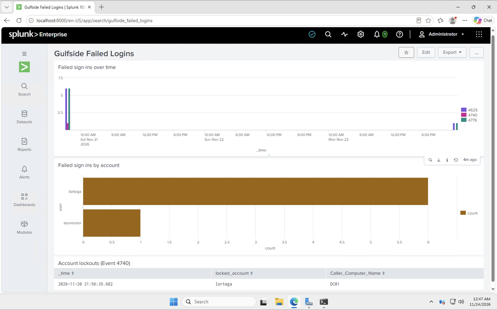
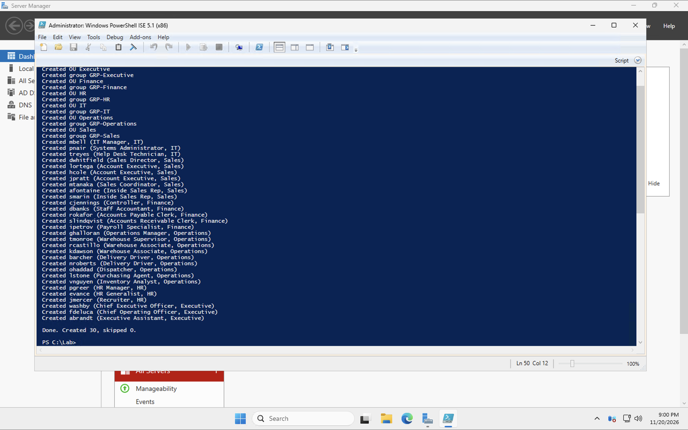
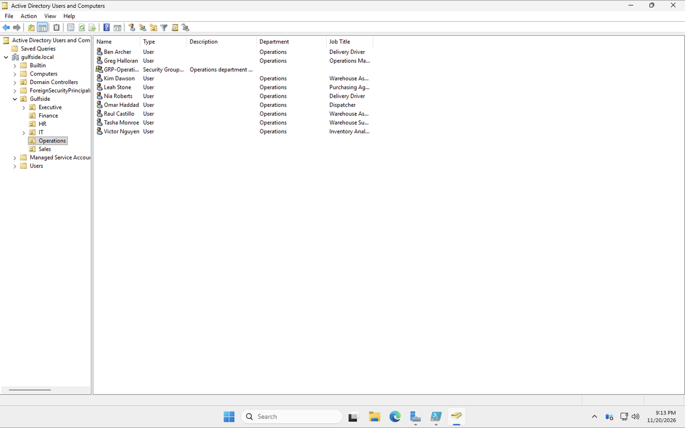
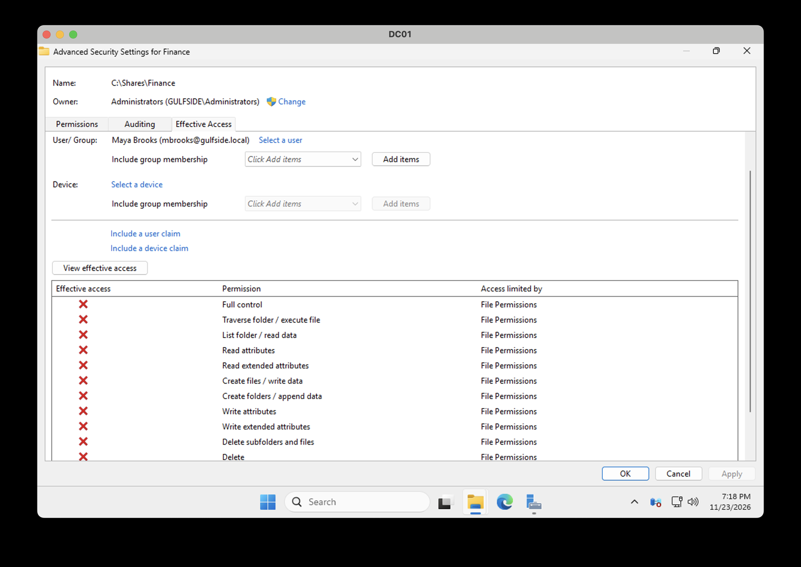
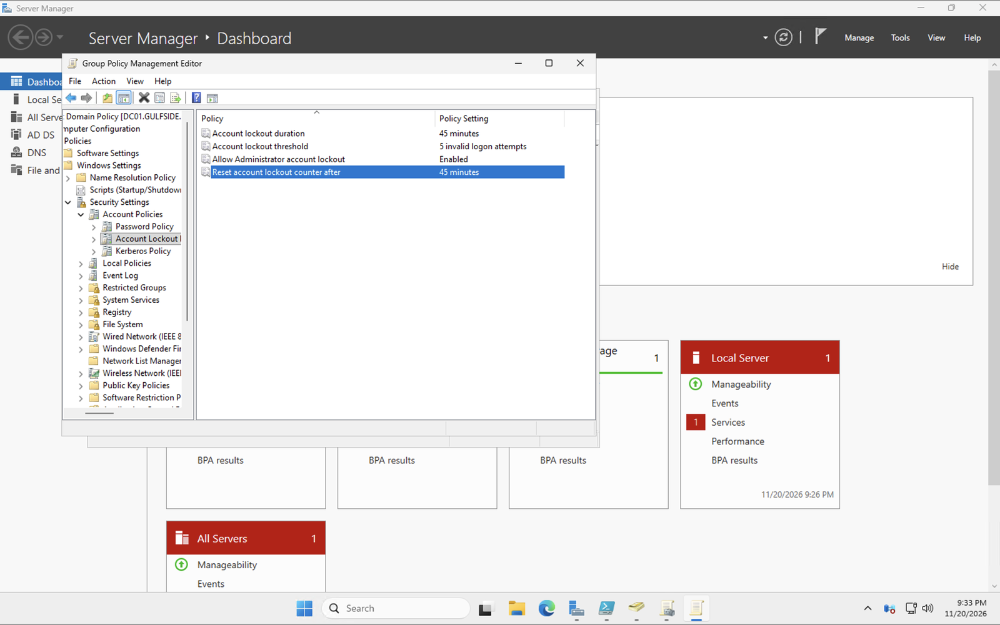
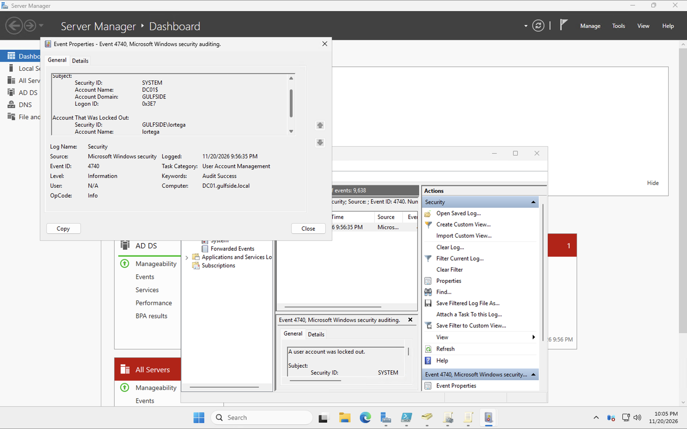

# Active Directory Home Lab: Gulfside Supply Co.

A Windows Server domain for a fictional 31-person company, built in Microsoft Azure and run the way a small IT department would run it: users created by script, ten help desk tickets worked with before-and-after evidence, and a security layer that ends in a Splunk dashboard of failed logins.

Built November 19 to 23, 2026 by Dien Elsayed (CompTIA Security+, Network+, Splunk Core Certified User).



## What is in the lab

| Piece | Detail |
| --- | --- |
| Server | DC01, Windows Server 2025 Datacenter, Azure VM (2 vCPU, 4 GB) |
| Domain | `gulfside.local`, with Active Directory Domain Services and DNS |
| Company | Gulfside Supply Co.: IT, Sales, Finance, Operations, HR, Executive |
| Structure | One OU and one security group (`GRP-<Department>`) per department |
| Naming | First initial plus last name, for example `mbrooks` |
| Logging | Splunk Enterprise 10.6 reading the Windows Security event log |
| Access | Remote Desktop allowed only from one home IP address through an Azure network security group |
| Cost control | Nightly auto-shutdown, and the VM is deallocated between sessions |

Why Azure: the lab was built from an Apple Silicon Mac, which cannot run Windows Server locally.

## 1. Users created by script

`scripts/New-LabUsers.ps1` reads `scripts/users.csv` and builds the directory: the company OU, an OU and security group per department, each user with department, title and company, group membership, and then managers in a second pass.

- It asks for the starting password when it runs, so no password is stored in the file.
- Every account must change its password at first sign-in.
- It is safe to run twice. Anything that already exists is skipped.





## 2. Ten help desk tickets

| # | Request | What was done | Evidence |
| --- | --- | --- | --- |
| 1 | Hannah Cole forgot her password | Reset with "must change at next sign-in" | [21](screenshots/21-ticket1-hannah-cole-password-reset.png) |
| 2 | Victor Nguyen moved from Operations to Finance | Moved the account to the Finance OU, swapped group membership, updated department and title | [22](screenshots/22-ticket2-victor-nguyen-member-of-finance.png), [23](screenshots/23-ticket2-finance-ou-after-victor.png) |
| 3 | Ben Archer left the company | Disabled the account rather than deleting it | [24](screenshots/24-ticket3-ben-archer-disabled.png) |
| 4 | Luis Ortega is locked out | Found Event ID 4740 in the Security log, confirmed bad passwords, unlocked the account | [29](screenshots/29-ticket4-lockout-test-luis-ortega-locked.png), [30](screenshots/30-ticket4-luis-ortega-unlock-account-tab.png), [31](screenshots/31-ticket4-event-4740-lockout.png) |
| 5 | New hire Maya Brooks joins Sales | Created `mbrooks`, set title and manager, added to `GRP-Sales` | [32](screenshots/32-ticket5-maya-brooks-organization-tab.png), [33](screenshots/33-ticket5-maya-brooks-member-of-grp-sales.png), [34](screenshots/34-ticket5-sales-ou-with-maya-brooks.png) |
| 6 | Finance needs a private shared folder | Disabled inheritance on `C:\Shares\Finance`, removed Users, granted `GRP-Finance` Modify, verified with Effective Access | [35](screenshots/35-ticket6-finance-folder-permissions-grp-finance.png), [36](screenshots/36-ticket6-effective-access-devon-banks-allowed.png), [37](screenshots/37-ticket6-effective-access-maya-brooks-denied.png) |
| 7 | Unattended screens must lock | Group Policy: password-protected screen saver after 600 seconds | [38](screenshots/38-ticket7-gpo-personalization-three-enabled.png), [39](screenshots/39-ticket7-gpo-settings-report-600-seconds.png) |
| 8 | Contractor needs access for 90 days | Created `jellis` with an account expiry date | [40](screenshots/40-ticket8-jordan-ellis-account-expires.png) |
| 9 | Sofia Marin was deleted by mistake | Enabled the AD Recycle Bin and restored the account | [41](screenshots/41-ticket9-sofia-marin-in-deleted-objects.png), [42](screenshots/42-ticket9-sofia-marin-restored-to-sales.png) |
| 10 | Passwords are too weak | Domain password policy: 12 characters, complexity on, 90-day maximum age, 24 remembered | [43](screenshots/43-ticket10-password-policy.png) |

The ticket that shows the most is number 6. The permission was not just set, it was tested: a Finance user is allowed and a Sales user is denied.



## 3. Security layer

**Account lockout policy.** Accounts lock after 5 bad passwords for 45 minutes, set in the Default Domain Policy.



**Tested on purpose.** `scripts/Invoke-LockoutTest.ps1` sends six wrong passwords for one user and then lists locked accounts. It uses deliberately wrong values, so no real password is involved.

**Investigated.** The domain controller logged Event ID 4740 naming the locked account and the time.



**Sent to Splunk.** Splunk Enterprise collects the Security log, and a dashboard called Gulfside Failed Logins shows failed sign-ins over time, failed sign-ins by account, and every lockout. The searches are in [`splunk/searches.md`](splunk/searches.md).

| Event ID | Meaning |
| --- | --- |
| 4625 | An account failed to log on |
| 4776 | The domain controller attempted to validate credentials |
| 4740 | A user account was locked out |

## 4. What went wrong, and the fix

- **A lockout test froze.** `runas` waits for a console password prompt that PowerShell ISE cannot show. Replaced it with `Invoke-LockoutTest.ps1`, which needs no prompt.
- **The server ran overnight.** Auto-shutdown had not actually saved. It was set again, confirmed by reloading the page, and the VM is now checked as "Stopped (deallocated)" after every session.
- **A screen-lock policy was named "10 minute" but set to 900 seconds.** Caught in the policy report and corrected to 600.
- **The Splunk admin password was lost.** `scripts/Reset-SplunkAdmin.ps1` resets it with a prompt and stores nothing.
- **A Splunk search returned nothing.** The time range was "All time (real-time)", which only shows new events. Switched to "All time".

## Files

```
scripts/
  New-LabUsers.ps1        Builds OUs, groups and users from users.csv
  users.csv               The 30 starting employees (fictional)
  Invoke-LockoutTest.ps1  Triggers the lockout policy for one user
  Reset-SplunkAdmin.ps1   Resets a forgotten local Splunk admin password
splunk/
  searches.md             The three dashboard searches
screenshots/              Evidence, numbered in the order it was captured
```

## Next steps

- A Splunk alert that fires when Event 4740 appears
- A second machine joined to the domain, to test the policies from a workstation

Every person and the company in this lab are fictional.
